# Calculator API CI/CD Report

## Architecture

```mermaid
flowchart LR
    G[GitHub push] --> J[Jenkins]
    J --> C[Checkout]
    C --> B[Maven build]
    B --> T[JUnit tests and reports]
    T --> D[Docker image build]
    D --> P[Docker Hub]
    P --> DC[Docker Compose deploy]
    DC --> N[Nginx]
    N --> A[Calculator API]
    A --> H[Actuator health check]
    H --> E[Email status]
```

## Pipeline stages

The GitHub webhook triggers the declarative Jenkins pipeline. Jenkins checks out the current revision, builds the Maven project, and runs the JUnit suite. Surefire XML reports are published even when a test fails. It builds two Docker tags: the Jenkins build number for an immutable deployment and `latest` for convenient local use.

Docker Hub authentication uses the Jenkins credential named `dockerhub-creds`; no password or token is committed. The selected build-number tag is deployed through Docker Compose. The API runs behind Nginx, and the deployment stage polls the public Actuator health endpoint before marking the build successful. Jenkins sends success or failure email through the Email Extension plugin.

## Container design

The Dockerfile has a Maven builder stage and a small Eclipse Temurin JRE Alpine runtime stage. Maven dependencies are resolved before application source is copied so Docker can reuse the dependency layer. The runtime image contains only the executable JAR and runs under an unprivileged `appuser` account. It exposes port 8080 and provides a health probe at `/actuator/health`.

Compose starts the calculator API and Nginx on a dedicated network. The API health check is required before Nginx starts. Both services have restart policies, and the proxy publishes the application on the host port configured by `API_PORT`.

## Verification and challenges

`mvn test` completed successfully with seven tests: the four arithmetic operations, division by zero, a MockMvc endpoint test, and a structured-error integration test. The Docker image was built locally and the Compose stack was tested through Nginx with `GET /actuator/health` and `GET /api/v1/divide?a=9&b=2`.

Before the live demo, configure the Jenkins SMTP settings with the existing `gmail-smtp` credential, create the Docker Hub `calculator-api` repository, and add the GitHub webhook. Capture the required green-pipeline, email, `docker ps`, and API-response screenshots from that genuine Jenkins run.
